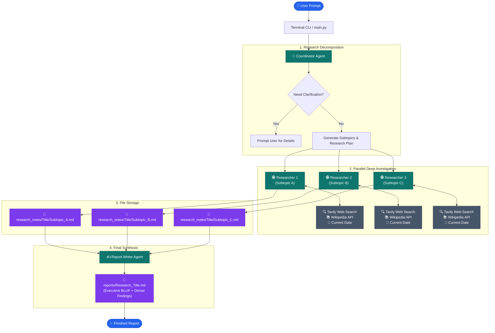

# 🔬 Deep Research Agents

[](https://www.python.org/)
[](https://python.langchain.com/)
[](https://openrouter.ai/)
[](https://www.docker.com/)
[](LICENSE)

An autonomous multi-agent deep research system powered by **LangChain**, **OpenRouter**, and **Google Gemini**. It decomposes complex, ambiguous questions into targeted subtopics, conducts parallel ReAct-style web investigations via Tavily and Wikipedia, and synthesizes dense, executive-ready markdown reports complete with inline citations and BLUF (Bottom Line Up Front) summaries.

---

## 📑 Table of Contents

- [System Architecture](#-system-architecture)
- [Multi-Agent Pipeline](#-multi-agent-pipeline)
- [Key Features](#-key-features)
- [Quick Start](#-quick-start)
  - [Prerequisites](#prerequisites)
  - [Local Installation](#option-a-local-installation)
  - [Docker & Docker Compose](#option-b-docker--docker-compose)
- [Configuration (.env)](#-configuration-env)
- [Recommended Models](#-recommended-models)
- [CLI Usage & Examples](#-cli-usage--examples)
- [Repository Structure](#-repository-structure)
- [Troubleshooting & FAQ](#-troubleshooting--faq)
- [License](#-license)

---

## 🏛 System Architecture

The pipeline divides the research workload across specialized, single-responsibility agents operating in sequence and parallel:



---

## 🤖 Multi-Agent Pipeline

1. **Coordinator Agent (`agents/coordinator.py`)**:
   - Analyzes the input prompt.
   - Determines if essential context or geography is missing.
   - Decomposes the research question into mutually exclusive, collectively exhaustive subtopics with specific objectives, key questions, suggested sources, and boundaries.

2. **Researcher Agents (`agents/researcher.py`)**:
   - Spawn in parallel threads using `ThreadPoolExecutor`.
   - Execute a multi-step ReAct loop with real-time tool calls (`tavily_search`, `wikipedia`, `get_current_date`).
   - Distinguish facts from conjecture, surface gaps, and save formatted markdown notes into `research_notes/{title}/`.

3. **Report Writer Agent (`agents/report_writer.py`)**:
   - Ingests all notes generated across all parallel subtopic agents.
   - Synthesizes findings into a comprehensive report following the **BLUF** (Bottom Line Up Front) executive format.
   - Formats dense narratives with bold evidence metrics and strict inline source citations ([Source](URL)).
   - Persists the final output to `reports/{title}.md`.

---

## ⚡ Key Features

- **Multi-Provider LLM Factory**: Works out of the box with **OpenRouter** (supporting 1M-token free models like Nemotron) and **Google Gemini**, with automatic fallbacks.
- **Concurrent Execution**: Multi-threaded researcher execution with configurable worker limits (`DR_MAX_RESEARCHERS`) and concurrency bounds (`DR_CONCURRENCY`).
- **Resilient Tool Dispatch**: Compatible with modern LangChain tool bindings across both OpenAI/OpenRouter schema and Google GenAI format.
- **Zero Hallucination Leaks**: Writer is strictly constrained to cite only verified URLs surfaced by the research notes.
- **Production-Ready Dockerization**: Includes lightweight `Dockerfile` and `docker-compose.yml` with persistent report volume mounts.

---

## 🚀 Quick Start

### Prerequisites

- **Python 3.11+** (or [Docker](https://docs.docker.com/get-docker/))
- **Tavily API Key**: Free tier available at [tavily.com](https://tavily.com/)
- **OpenRouter API Key** (at [openrouter.ai](https://openrouter.ai/)) or **Google Gemini API Key** (at [aistudio.google.com](https://aistudio.google.com/))

---

### Option A: Local Installation

1. **Clone the repository**:
   ```bash
   git clone https://github.com/<your-username>/deep-research-agents.git
   cd deep-research-agents
   ```

2. **Create and activate a virtual environment**:
   ```bash
   python3 -m venv .venv
   source .venv/bin/activate  # On Windows: .venv\Scripts\activate
   ```

3. **Install dependencies**:
   ```bash
   pip install --upgrade pip
   pip install -r requirements.txt
   ```

4. **Configure environment variables**:
   ```bash
   cp .env.example .env
   ```
   Open `.env` and paste your API keys.

5. **Run the research agent**:
   ```bash
   # Interactive prompt:
   python main.py

   # Or pass your question directly:
   python main.py "Commercial adoption and security state of AI agents in 2026"
   ```

---

### Option B: Docker & Docker Compose

Run the entire research system inside an isolated container with zero local dependency management.

1. **Configure `.env`**:
   ```bash
   cp .env.example .env
   # Add your OPENROUTER_API_KEY (or GOOGLE_API_KEY) and TAVILY_API_KEY
   ```

2. **Run with Docker Compose**:
   ```bash
   # Run interactively:
   docker compose run --rm deep-research

   # Or pass a research query directly:
   docker compose run --rm deep-research "State of fusion energy in 2026"
   ```

3. **Or run with Docker CLI directly**:
   ```bash
   # Build the image
   docker build -t deep-research-agents .

   # Execute and mount reports directory
   docker run --rm -it \
     --env-file .env \
     -v $(pwd)/reports:/app/reports \
     -v $(pwd)/research_notes:/app/research_notes \
     deep-research-agents "Future of quantum cryptography"
   ```

All generated reports will automatically be saved to your host machine's `./reports/` directory.

---

## ⚙️ Configuration (.env)

| Variable | Required | Default | Description |
| :--- | :---: | :---: | :--- |
| `OPENROUTER_API_KEY` | Optional* | — | Key for OpenRouter API. |
| `GOOGLE_API_KEY` | Optional* | — | Key for Google Gemini API. |
| `TAVILY_API_KEY` | **Yes** | — | Web search API key for live search queries. |
| `DR_MODEL` | No | `nvidia/nemotron-3-ultra-550b-a55b:free` | Model identifier to use. |
| `DR_MAX_RESEARCHERS` | No | `3` | Maximum number of parallel researcher agents. |
| `DR_MAX_STEPS` | No | `6` | Maximum tool-call reasoning steps per researcher. |
| `DR_CONCURRENCY` | No | `3` | Maximum concurrent LLM network calls. |

*\*Note: At least one LLM key (`OPENROUTER_API_KEY` or `GOOGLE_API_KEY`) must be configured.*

---

## 🧠 Recommended Models

| Model Slug | Provider | Context Window | Best For |
| :--- | :---: | :---: | :--- |
| **`nvidia/nemotron-3-ultra-550b-a55b:free`** | OpenRouter (Free) | **1,000,000** | Flagship reasoning, high accuracy, massive context. |
| **`nvidia/nemotron-3.5-lightning:free`** | OpenRouter (Free) | **1,000,000** | Rapid tool calling and low latency investigations. |
| **`deepseek/deepseek-v4.1-flash-1017`** | OpenRouter | 131,072 | Fast, high-efficiency research tasks. |
| **`gemini-3.5-flash`** | Google AI Studio | 1,000,000 | Native multimodal reasoning and high throughput. |

Override models on the fly using the `--model` flag:
```bash
python main.py "Advances in CRISPR" --model nvidia/nemotron-3.5-lightning:free
```

---

## 💻 CLI Usage & Examples

```bash
# General usage:
python main.py [OPTIONS] [QUERY]

# Options:
#   -h, --help                 Show help message and exit
#   -c, --clarifications TEXT  Provide upfront clarification context
#   -m, --model MODEL_NAME     Override default model
```

### Example Run:

```text
$ python main.py "Commercial adoption and security state of AI agents in 2026"

╭──────────────────────── Deep Research Started ────────────────────────╮
│ Commercial adoption and security state of AI agents in 2026           │
╰───────────────────────────────────────────────────────────────────────╯

→ Coordinator is planning...

Research Title: AI Agents State 2026
Subtopics (3):
  1. Market Architecture and Protocol Standardization
  2. Commercial Adoption and Enterprise ROI
  3. Safety, Evaluation and Runtime Guardrails

→ Starting parallel research...
  Researching: Market Architecture and Protocol Standardization
  Researching: Commercial Adoption and Enterprise ROI
  Researching: Safety, Evaluation and Runtime Guardrails

✓ All research notes collected (3)

→ Writing final report...

✅ Final report saved: /app/reports/AI_Agents_State_2026.md

╭─────────────────────────────── Finished ──────────────────────────────╮
│ Research Complete!                                                    │
│                                                                       │
│ Title: AI Agents State 2026                                           │
│ Notes saved in: research_notes/AI_Agents_State_2026/                   │
│ Final report: reports/AI_Agents_State_2026.md                         │
╰───────────────────────────────────────────────────────────────────────╯
```

---

## 📂 Repository Structure

```text
deep-research-agents/
├── agents/                     # Agent implementations
│   ├── __init__.py
│   ├── coordinator.py          # Plans & decomposes research topics
│   ├── researcher.py           # Parallel ReAct tool-calling researcher
│   ├── report_writer.py        # Report synthesis & BLUF compilation
│   └── llm_factory.py          # Unified OpenRouter / Gemini LLM provider
├── prompts/                    # Carefully tuned agent system prompts
│   ├── coordinator_prompt.py
│   ├── researcher_prompt.py
│   └── report_writer_prompt.py
├── tools/                      # External agent tools
│   ├── __init__.py
│   └── research_tools.py       # Tavily Search, Wikipedia & file storage
├── reports/                    # Persisted research reports (.gitkeep)
├── research_notes/             # Detailed subtopic markdown notes (.gitkeep)
├── .dockerignore               # Docker ignore rules
├── .env.example                # Sample environment template
├── .gitignore                  # Git ignore rules (protects API keys)
├── docker-compose.yml          # Container compose service
├── Dockerfile                  # Container build instructions
├── main.py                     # CLI entry point
└── requirements.txt            # Python package dependencies
```

---

## ❓ Troubleshooting & FAQ

<details>
<summary><b>1. Error: 402 - Insufficient credits on OpenRouter</b></summary>

If you receive a `402 Insufficient credits` error when using a paid model (like `deepseek/...`), switch to a free model in your `.env` file:
```env
DR_MODEL=nvidia/nemotron-3-ultra-550b-a55b:free
```
Or purchase credits at [openrouter.ai/settings/credits](https://openrouter.ai/settings/credits).
</details>

<details>
<summary><b>2. Tavily Search returns rate limit or quota exceeded</b></summary>

Verify that your `TAVILY_API_KEY` is active at [app.tavily.com](https://app.tavily.com/). You can reduce `DR_MAX_STEPS` in `.env` to make researchers complete their queries in fewer calls.
</details>

<details>
<summary><b>3. Are my API keys safe when pushing to GitHub?</b></summary>

Yes! The `.gitignore` file is strictly configured to ignore `.env` and any `.env.*` secrets files. Only `.env.example` (which contains dummy values) is tracked by git. Always run `git status` before pushing to verify untracked files.
</details>

---

## 📄 License

This project is licensed under the [MIT License](LICENSE).
